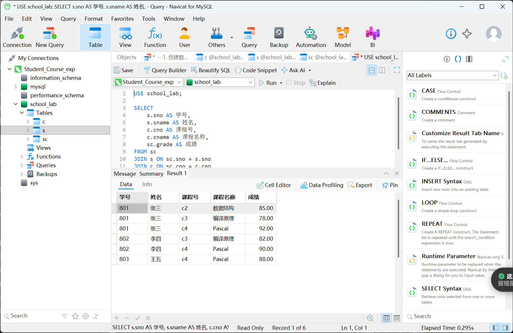
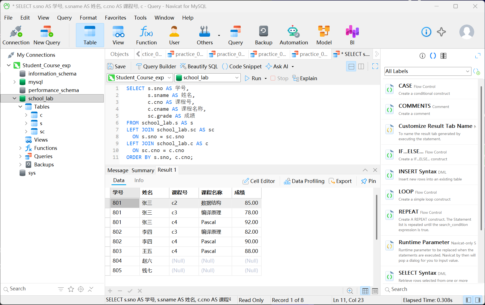

# Student_Course_sql_lab
Windows+MySQL+Navicat 学生选课数据库实验与SQL查询练习
# Windows 下使用 MySQL 与 Navicat 搭建学生选课数据库及 SQL 查询实践

本实验使用 MySQL 作为数据库服务器、Navicat 作为图形化管理客户端，建立学生、课程、选课三张表，并完成条件查询、分组统计、多表连接和嵌套查询等练习。

本文记录实验环境、建表与数据录入过程、实际查询结果，以及实验中发现的数据完整性问题。

## 一、实验目标与环境

实验目标：

1. 在 Windows 上安装、配置 MySQL，并使用 Navicat 连接。
2. 按题目建立学生表 S、课程表 C、选课表 SC。
3. 录入原题数据并核对。
4. 通过 SQL 查询理解筛选、分组、连接、空值和子查询。

| 项目 | 实验配置 |
|---|---|
| 操作系统 | Windows |
| 数据库服务器 | MySQL Community Server 8.4.11 |
| 图形化客户端 | Navicat 18 for MySQL，试用版 |
| Navicat 连接名称 | Student_Course_exp |
| 主机 | localhost |
| 端口 | 3306 |
| 实验数据库 | school_lab |
| 字符集 | utf8mb4 |
| 存储引擎 | InnoDB |


## 二、安装与连接

### 2.1 安装 MySQL

从 MySQL 官方网站下载 Windows 64 位 MSI 安装包，使用 Typical 安装方式。

安装完成后启动 MySQL Configurator，完成以下配置：

- 配置类型使用 Development Computer。
- 启用 TCP/IP，端口为 3306。
- 为 root 设置密码。
- 将 MySQL 配置为 Windows 服务，服务名称为 MySQL84。
- 应用配置，初始化数据库并启动服务。

### 2.2 使用 Navicat 连接

在 Navicat 中新建 MySQL 连接，填写：

- Connection Name：Student_Course_exp
- Host：localhost
- Port：3306
- User Name：root
- Password：安装时设置的密码

连接成功后，可以看到 MySQL 的系统数据库，服务器版本显示为 8.4.11。


## 三、数据库设计

题目给出的关系模式为：

```text
S(sno, sname, ssex, sdept, sage)
C(cno, cname, credit, cpno)
SC(sno, cno, grade)
```

### 3.1 字段与主键

| 表 | 字段 | 含义 |
|---|---|---|
| S | sno、sname、ssex、sdept、sage | 学号、姓名、性别、院系编号、年龄 |
| C | cno、cname、credit、cpno | 课程号、课程名称、学分、先修课程号 |
| SC | sno、cno、grade | 学号、课程号、成绩 |

主键与关系：

- S 的主键为 sno。
- C 的主键为 cno。
- SC 使用 (sno, cno) 联合主键，避免同一个学生重复选修同一门课程。
- SC.sno 外键引用 S.sno。
- SC.cno 外键引用 C.cno。

### 3.2 数据类型选择

- 学号和课程号是标识符，采用字符类型。
- 院系编号使用 CHAR(2)，保留 01、02 中的前导零。
- 学分包含 3.5，采用 DECIMAL(3,1)。
- 成绩采用 DECIMAL(5,2)，允许为 NULL，表示尚未记录成绩。

### 3.3 原题中的先修课程问题

原题中 c3“编译原理”的先修课程号为 c6，但给出的课程表只有 c1 至 c4，没有 c6 的课程记录。

为保留原题：

1. 保留 c3.cpno = 'c6'。
2. 不自行补造 c6 的课程名称、学分等信息。


## 四、建立数据库与录入数据

以下脚本用于首次创建实验库。

```sql
SET NAMES utf8mb4;
CREATE DATABASE school_lab
CHARACTER SET utf8mb4 COLLATE utf8mb4_0900_ai_ci;
USE school_lab;

CREATE TABLE s (
    sno CHAR(3) PRIMARY KEY,
    sname VARCHAR(20) NOT NULL,
    ssex CHAR(1) NOT NULL,
    sdept CHAR(2) NOT NULL,
    sage TINYINT UNSIGNED NOT NULL);

CREATE TABLE c (
    cno CHAR(2) PRIMARY KEY,
    cname VARCHAR(40) NOT NULL,
    credit DECIMAL(3,1) NOT NULL,
    cpno CHAR(2));

CREATE TABLE sc (
    sno CHAR(3) NOT NULL,
    cno CHAR(2) NOT NULL,
    grade DECIMAL(5,2),
    PRIMARY KEY (sno, cno),
    FOREIGN KEY (sno) REFERENCES s(sno),
    FOREIGN KEY (cno) REFERENCES c(cno));

INSERT INTO s (sno,sname,ssex,sdept,sage) VALUES
('801','张三','女','01',19),
('802','李四','男','01',20),
('803','王五','男','01',20),
('804','赵六','女','02',20),
('805','钱七','男','02',19);

INSERT INTO c (cno,cname,credit,cpno) VALUES
('c1','数据库',3.5,'c2'),
('c2','数据结构',4.0,'c4'),
('c3','编译原理',4.0,'c6'),
('c4','Pascal',3.0,NULL);

INSERT INTO sc (sno,cno,grade) VALUES
('801','c4',92),('801','c3',78),('801','c2',85),
('802','c3',82),('802','c4',90),('803','c4',88);

SELECT 'S' AS table_name, COUNT(*) AS row_count FROM S
UNION ALL
SELECT 'C', COUNT(*) FROM C
UNION ALL
SELECT 'SC', COUNT(*) FROM SC;
```

运行后，记录如下：

| 表 | 记录数 |
|---|---:|
| S | 5 |
| C | 4 |
| SC | 6 |

在 Navicat 中分别打开三张表，逐项核对后，数据与题目一致。


## 五、三表关联查询

将学号对应的学生姓名、课程号对应的课程名称与成绩连接起来。

```sql
SELECT s.sno AS 学号,
       s.sname AS 姓名,
       c.cno AS 课程号,
       c.cname AS 课程名称,
       sc.grade AS 成绩
FROM school_lab.sc AS sc,
     school_lab.s AS s,
     school_lab.c AS c
WHERE sc.sno = s.sno
  AND sc.cno = c.cno
ORDER BY s.sno, c.cno;

```

实际结果：

| 学号 | 姓名 | 课程号 | 课程名称 | 成绩 |
|---|---|---|---|---:|
| 801 | 张三 | c2 | 数据结构 | 85.00 |
| 801 | 张三 | c3 | 编译原理 | 78.00 |
| 801 | 张三 | c4 | Pascal | 92.00 |
| 802 | 李四 | c3 | 编译原理 | 82.00 |
| 802 | 李四 | c4 | Pascal | 90.00 |
| 803 | 王五 | c4 | Pascal | 88.00 |

该查询使用内连接，只返回能够匹配到选课记录的学生。

## 六、SQL 查询练习

以下练习均已在本机执行，并核对了查询结果。

### 练习 1：查询 01 系中年龄不小于 20 岁的学生。

```sql
SELECT sno AS 学号,
       sname AS 姓名,
       sdept AS 院系,
       sage AS 年龄
FROM school_lab.s
WHERE sdept = '01'
  AND sage >= 20
ORDER BY sage DESC, sno ASC;
```

结果为 802 李四、803 王五，两人均属于 01 系，年龄均为 20 岁。

### 练习 2：查询名称中包含“数据”的课程。

```sql
SELECT cno AS 课程号,
       cname AS 课程名称,
       credit AS 学分
FROM school_lab.c
WHERE cname LIKE '%数据%'
ORDER BY cno;
```

结果为 c1“数据库”和 c2“数据结构”，学分分别为 3.5 和 4.0。

LIKE 用于模式匹配，% 可以匹配零个或多个字符，因此这两门课程都符合条件。

### 练习 3：

#### 3.1 查询已选课学生的学号

```sql
SELECT DISTINCT sno AS 已选课学生学号
FROM school_lab.sc
ORDER BY sno;
```

结果为 801、802、803。

选课表有 6 条记录，但只有 3 个不同的学生。DISTINCT 去掉查询结果中的重复学号，不会删除原表中的选课记录。

#### 3.2 根据学分折算学时

假设每学分对应 16 学时，计算各课程的折算学时。

```sql
SELECT cno AS 课程号,
       cname AS 课程名称,
       credit AS 学分,
       credit * 16 AS 折算学时
FROM school_lab.c
ORDER BY cno;
```

结果：

| 课程号 | 课程名称 | 学分 | 折算学时 |
|---|---|---:|---:|
| c1 | 数据库 | 3.5 | 56.0 |
| c2 | 数据结构 | 4.0 | 64.0 |
| c3 | 编译原理 | 4.0 | 64.0 |
| c4 | Pascal | 3.0 | 48.0 |


### 练习 4：查询选课至少两门，并且平均成绩不低于 85 分的学生。

```sql
SELECT s.sno AS 学号,
       s.sname AS 姓名,
       COUNT(*) AS 选课门数,
       ROUND(AVG(sc.grade), 2) AS 平均成绩
FROM school_lab.s AS s
JOIN school_lab.sc AS sc
  ON s.sno = sc.sno
GROUP BY s.sno, s.sname
HAVING COUNT(*) >= 2
   AND AVG(sc.grade) >= 85
ORDER BY 平均成绩 DESC, s.sno;
```

结果：

| 学号 | 姓名 | 选课门数 | 平均成绩 |
|---|---|---:|---:|
| 802 | 李四 | 2 | 86.00 |
| 801 | 张三 | 3 | 85.00 |

GROUP BY 将同一学生的选课记录分组；COUNT(*) 统计选课门数，AVG 计算平均成绩，ROUND 将显示结果四舍五入到两位小数。

WHERE 筛选分组前的记录，HAVING 筛选分组后的统计结果。本题筛选选课门数和平均成绩，因此使用 HAVING。


### 练习 5：显示所有学生的选课情况，包括没有选课的学生。

```sql
SELECT s.sno AS 学号, s.sname AS 姓名,
       c.cno AS 课程号, c.cname AS 课程名称, sc.grade AS 成绩
FROM school_lab.s AS s
LEFT OUTER JOIN school_lab.sc AS sc ON s.sno = sc.sno
LEFT OUTER JOIN school_lab.c AS c ON sc.cno = c.cno
ORDER BY s.sno, c.cno;
```

实际返回 8 行：原来的 6 条选课记录，以及赵六、钱七各一行。两人的课程号、课程名称和成绩均显示为 NULL。

| 连接方式 | 返回行数 | 未选课学生 |
|---|---:|---|
| 内连接 | 6 | 不显示 |
| 左外连接 | 8 | 保留 |

LEFT JOIN 保留左表中的所有学生。没有匹配到选课记录时，右侧字段显示为空值，不能将此解释为成绩为 0。

### 练习 6：

#### 6.1 查询课程及其先修课程名称

```sql
SELECT X.cno AS 课程号,
       X.cname AS 课程名称,
       X.cpno AS 先修课程号,
       Y.cname AS 先修课程名称
FROM school_lab.c AS X
LEFT OUTER JOIN school_lab.c AS Y ON X.cpno = Y.cno
ORDER BY X.cno;
```

结果：

| 课程号 | 课程名称 | 先修课程号 | 先修课程名称 |
|---|---|---|---|
| c1 | 数据库 | c2 | 数据结构 |
| c2 | 数据结构 | c4 | Pascal |
| c3 | 编译原理 | c6 | NULL |
| c4 | Pascal | NULL | NULL |

同一张课程表在查询中承担两个角色，分别用 current_course 和 prerequisite 两个别名区分，这就是自连接。

c3 的先修课程号存在，但对应课程记录缺失；c4 的先修课程号本身就是 NULL。两种情况需要区分。

#### 6.2 检查缺失的先修课程

```sql
SELECT X.cno AS 课程号,
       X.cname AS 课程名称,
       X.cpno AS 缺失的先修课程号
FROM school_lab.c AS X
LEFT OUTER JOIN school_lab.c AS Y ON X.cpno = Y.cno
WHERE X.cpno IS NOT NULL AND Y.cno IS NULL
ORDER BY X.cno;
```

结果只返回 c3“编译原理”，缺失的先修课程号为 c6。

两个条件的作用分别是：

- cpno IS NOT NULL：当前课程填写了先修课程号。
- prerequisite.cno IS NULL：连接时没有找到对应课程。

空值判断使用 IS NULL 或 IS NOT NULL，不能写成 = NULL。

### 练习 7：查询成绩高于该门课程平均成绩的选课记录。

```sql
SELECT s.sno AS 学号, s.sname AS 姓名,
       c.cname AS 课程名称, sc.grade AS 成绩
FROM school_lab.sc AS sc,
     school_lab.s AS s,
     school_lab.c AS c
WHERE sc.sno = s.sno
  AND sc.cno = c.cno
  AND sc.grade > (
      SELECT AVG(other_sc.grade)
      FROM school_lab.sc AS other_sc
      WHERE other_sc.cno = sc.cno
  )
ORDER BY s.sno, c.cno;
```

结果：

| 学号 | 姓名 | 课程名称 | 成绩 |
|---|---|---|---:|
| 801 | 张三 | Pascal | 92.00 |
| 802 | 李四 | 编译原理 | 82.00 |

子查询通过 other_sc.cno = sc.cno 引用了外层查询的课程号，因此计算的是当前课程的平均成绩，而不是全部选课记录的平均成绩。

### 练习 8：查询没有选修任何课程的学生。

```sql
SELECT s.sno AS 学号,
       s.sname AS 姓名
FROM school_lab.s AS s
WHERE NOT EXISTS (
    SELECT 1
    FROM school_lab.sc AS sc
    WHERE sc.sno = s.sno
)
ORDER BY s.sno;
```

结果：

| 学号 | 姓名 |
|---|---|
| 804 | 赵六 |
| 805 | 钱七 |

子查询检查当前学生是否存在选课记录，NOT EXISTS 保留没有匹配记录的学生。


## 七、实验中遇到的问题

### 7.1 新代码与默认查询拼接导致语法错误

新建查询后，编辑区原本存在：

```sql
SELECT * FROM `sc`
```

粘贴新代码时没有替换原文，导致第一行变成：

```sql
SELECT * FROM `sc`USE school_lab;
```

运行后出现 MySQL 1064 语法错误。

处理方法是删除多余的旧查询，让第一行只保留：

```sql
USE school_lab;
```

再次运行后，三表关联查询成功。

这说明粘贴 SQL 时需要检查语句是否完整、语句之间是否正确分隔。

### 7.2 建库后左侧列表没有立即出现新数据库

执行建库 SQL 后，刷新 Navicat 的连接列表，再展开 school_lab，即可查看新建的表。

### 7.3 查询结果中的 NULL 需要结合上下文解释

本实验中出现了不同来源的 NULL：

- 课程表中 c4.cpno 为 NULL：原题没有填写先修课程号。
- 先修课程自连接中 c3 的先修课程名称为 NULL：填写了 c6，但没有匹配到课程记录。
- 学生左外连接中赵六、钱七的课程和成绩为 NULL：没有匹配到选课记录。

虽然界面显示相同，产生空值的原因并不相同。

## 八、实验总结

本实验完成了 MySQL 与 Navicat 的连接、学生选课数据库的建立和原题数据录入，并通过查询结果核对了数据。

查询练习帮助理解了：

- 条件筛选、排序、模糊匹配与去重。
- SELECT 中的算术表达式。
- 聚合函数、分组与分组后的筛选。
- 内连接、左外连接和自连接。
- 空值判断、相关子查询与 NOT EXISTS。


## 参考资料

- [MySQL Community Server 下载](https://dev.mysql.com/downloads/mysql/8.4.html)
- [MySQL 8.4 Windows 安装说明](https://dev.mysql.com/doc/refman/8.4/en/windows-installation.html)
- [Navicat for MySQL 下载](https://www.navicat.com/en/download/navicat-for-mysql)


## SQL 文件与实验截图

- [建库、建表与初始化数据](01_setup.sql)
- [数据核对与三表关联查询](02_verify.sql)
- [八道 SQL 查询练习](03_queries.sql)
- [查看全部实验截图](SCREENSHOTS.md)
- [查询练习与课件范围核对](COURSE_SCOPE.md)

### 三表关联查询结果

通过学号和课程号连接学生、课程和选课表，查询结果包含 6 条选课记录。



### 左外连接查询结果

左外连接保留所有学生，结果包含 8 行。没有选课的赵六和钱七，其课程信息和成绩显示为 NULL。


