# 实验截图与运行结果

以下为本次实验中实际提供的 Navicat 截图，按搭建与查询顺序排列。图片保留原始内容，没有重绘或模拟结果。

[返回实验博客](README.md)

## 连接成功

Navicat 显示 MySQL 8.4.11，主机 localhost，端口 3306。

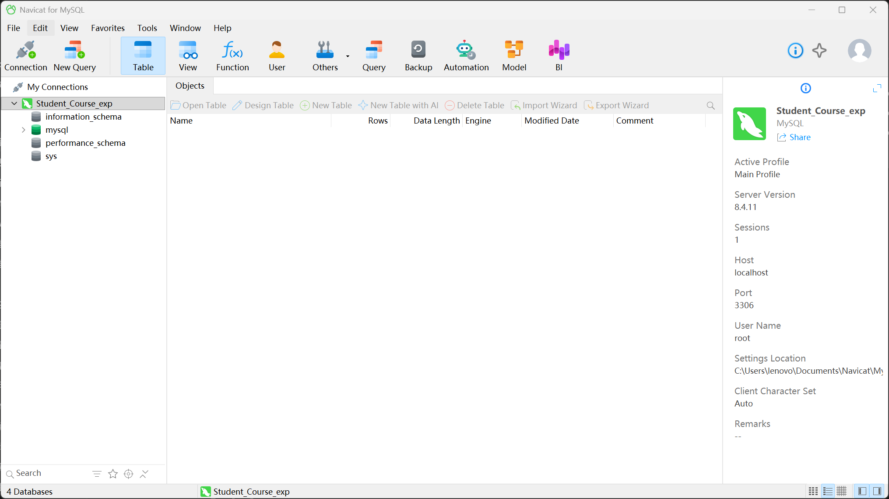

## 三张表记录数

S、C、SC 的记录数分别为 5、4、6。

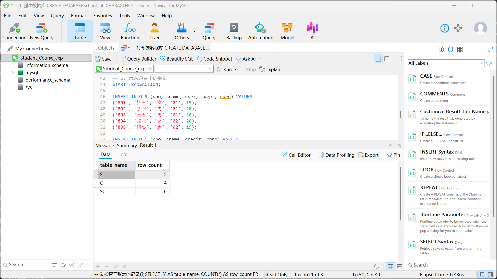

## 学生表

5名学生，院系编号的前导零得到保留。

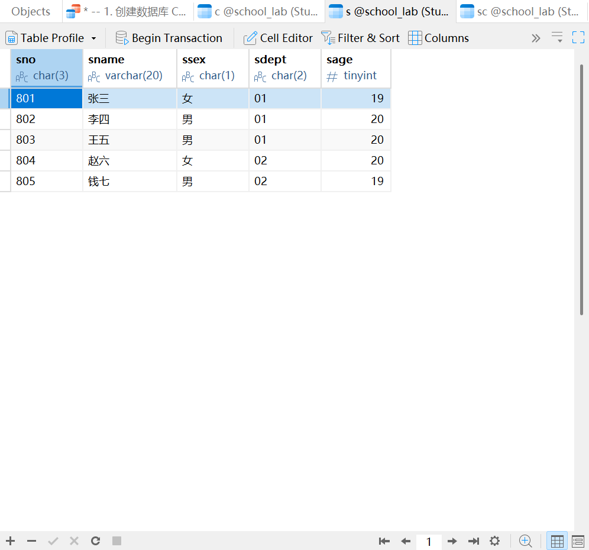

## 课程表

4门课程，保留原题 c3.cpno=c6 的数据。

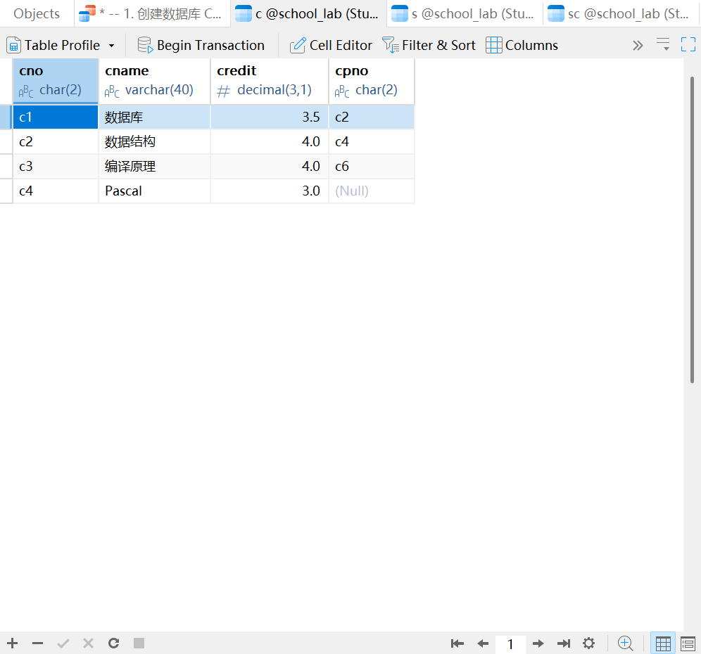

## 选课表

6条选课与成绩记录。

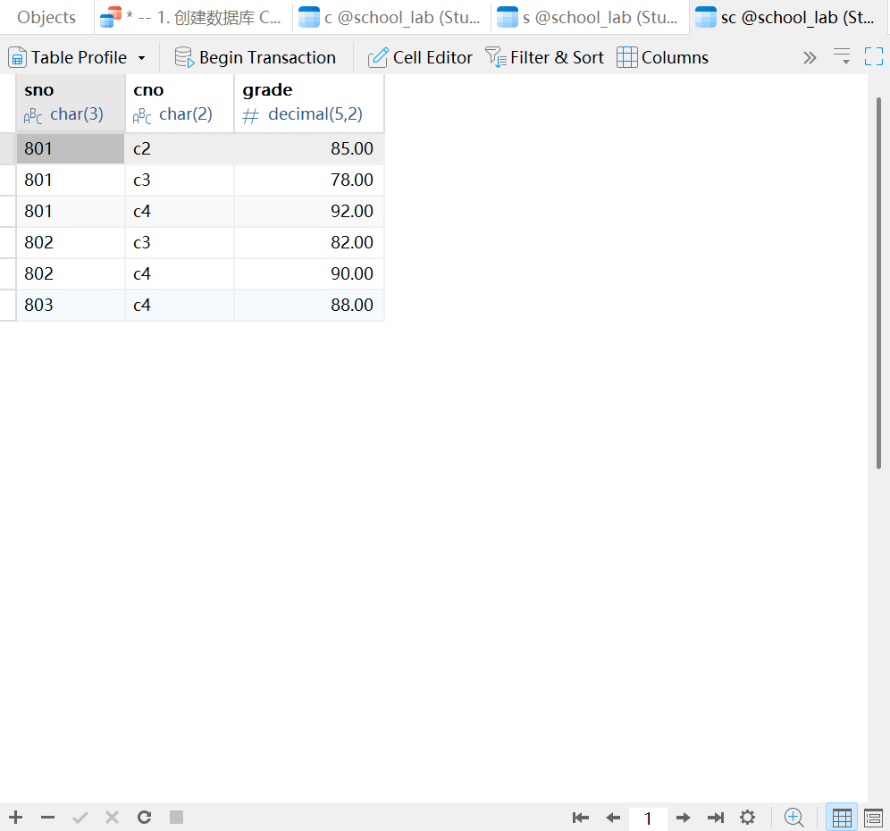

## 三表内连接

实际返回6行，展示姓名、课程名称和成绩。

## 练习1：条件查询与排序

满足01系且年龄不低于20岁的学生是李四、王五。

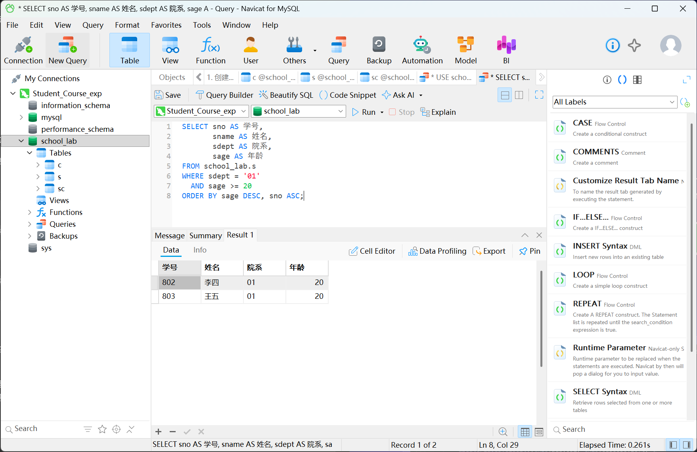

## 练习2：模糊查询

数据库、数据结构的名称均包含“数据”。

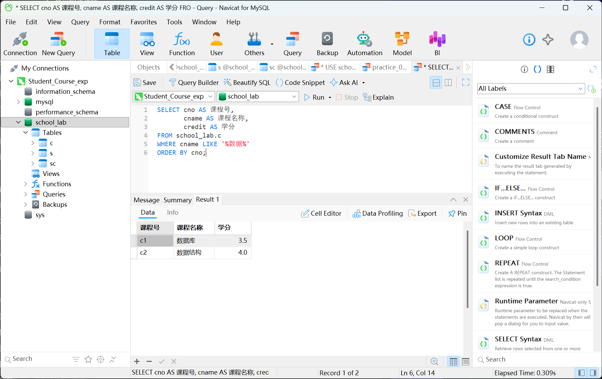

## 练习3a：去重

6条选课记录对应3个不同学号。

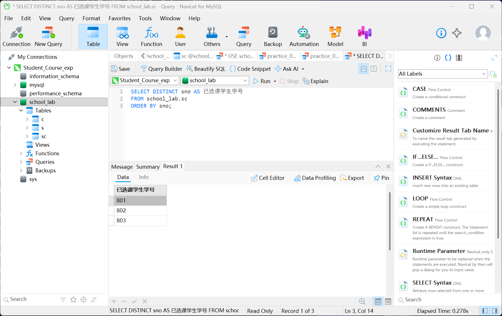

## 练习3b：算术表达式

假设每学分16学时，结果为56、64、64、48。

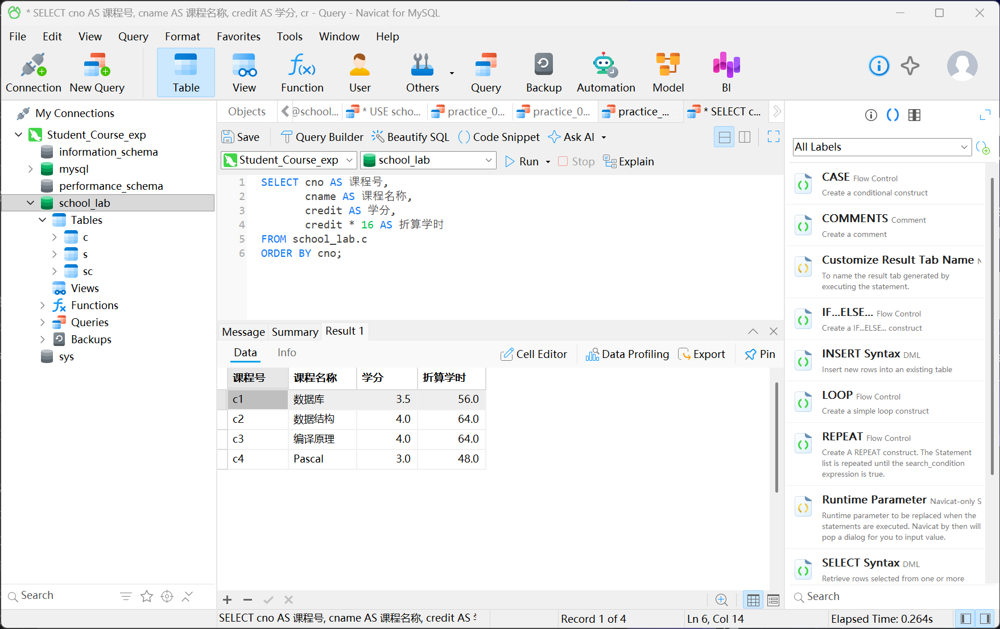

## 练习4：分组统计

李四2门86分，张三3门85分，符合HAVING条件。

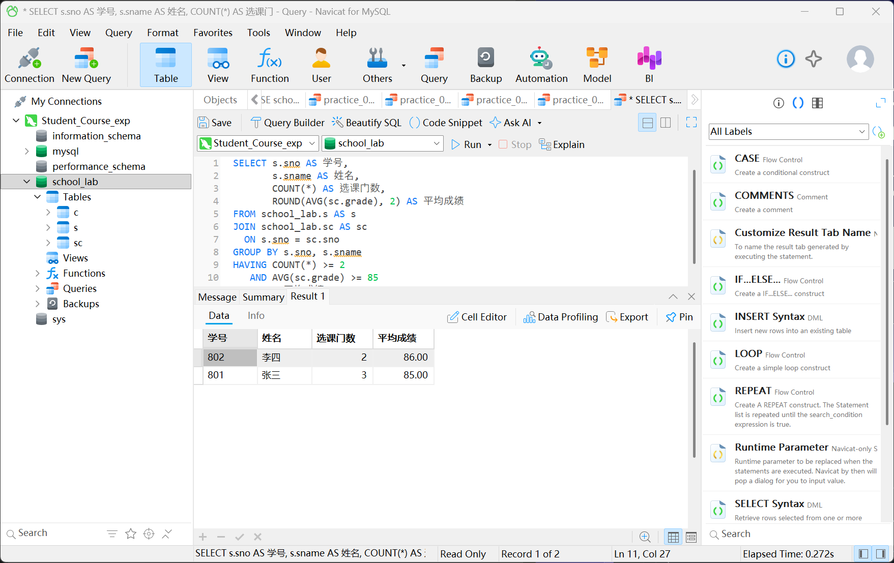

## 练习5：左外连接

8行结果保留了没有选课的赵六和钱七。

## 练习6a：自连接

显示课程与先修课程名称。

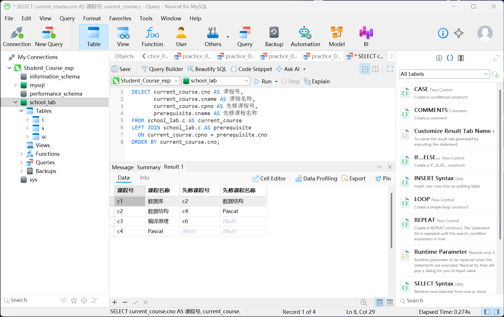

## 练习6b：先修课程缺失检查

c3引用的c6在课程表中不存在。

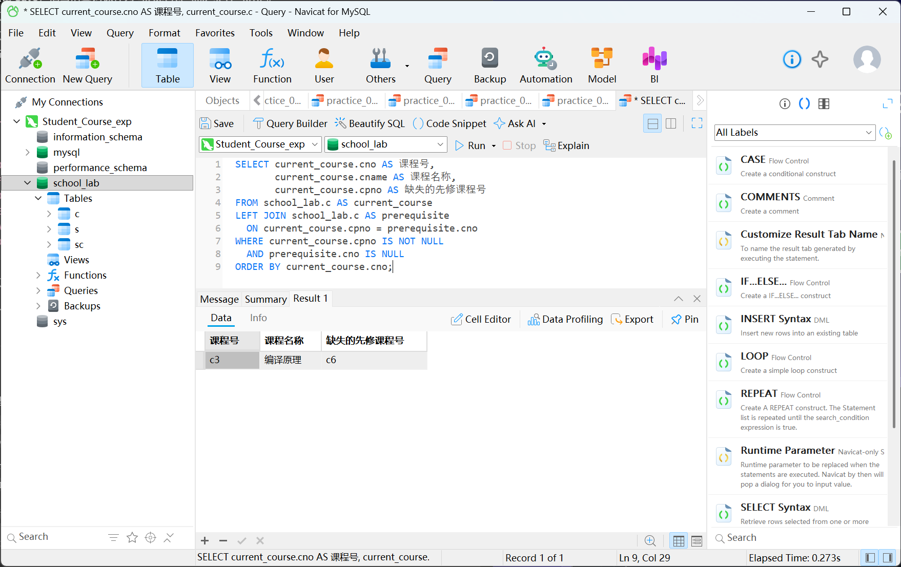

## 练习7：相关子查询

张三的Pascal成绩92、李四的编译原理成绩82高于各自课程平均分。

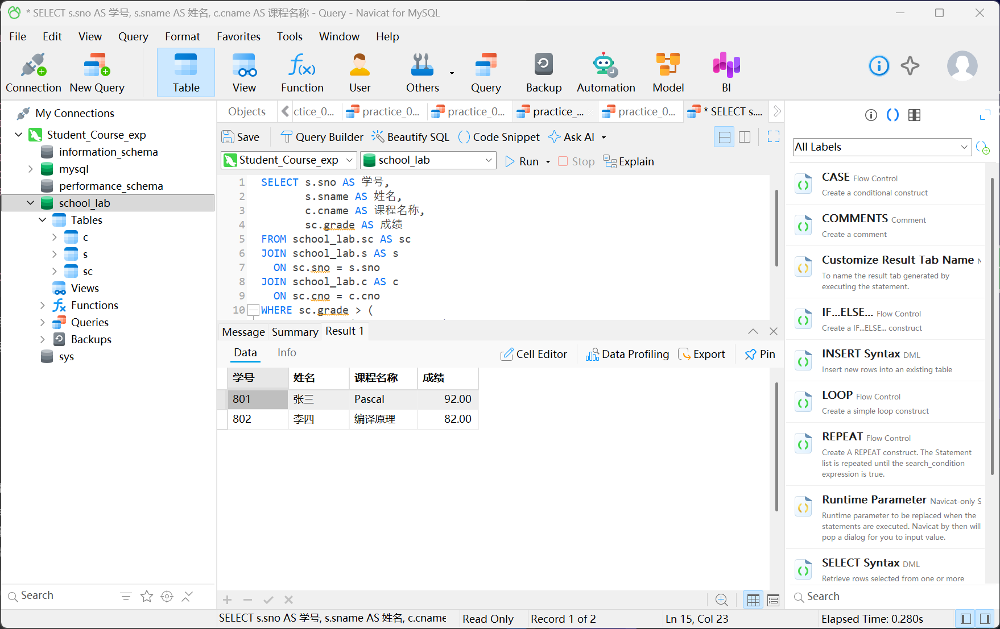

## 练习8：NOT EXISTS

没有选课的学生为804赵六、805钱七。

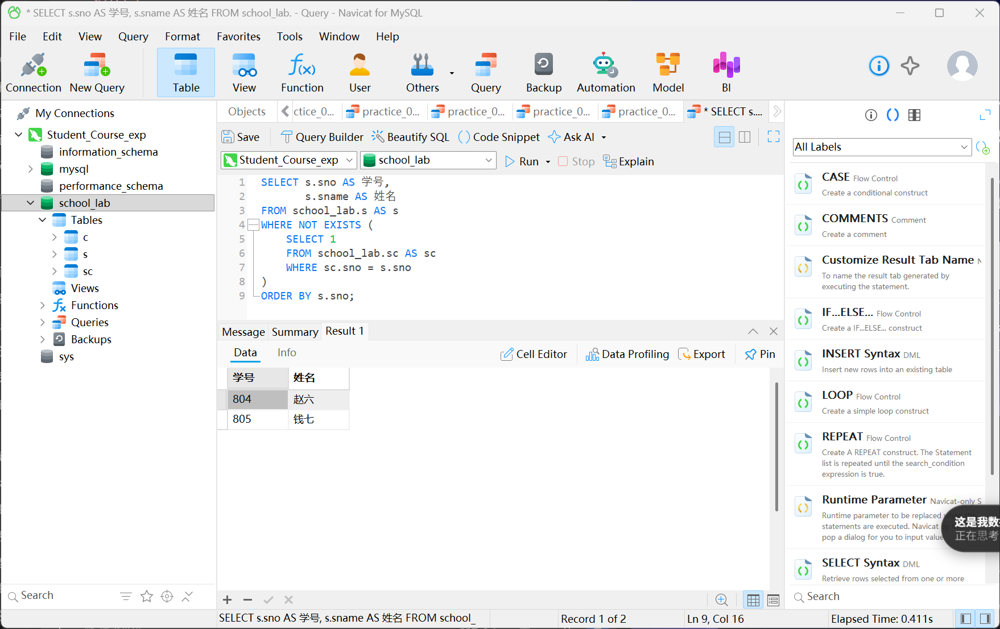
